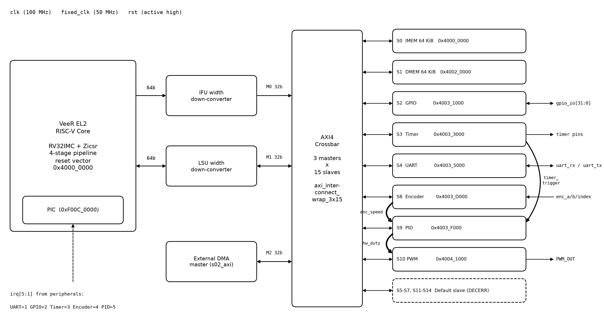
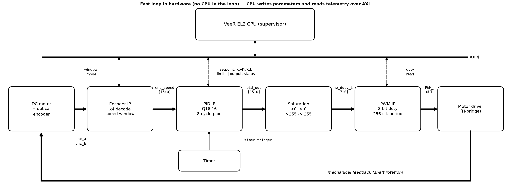

# Design and Verification of a Real-Time Closed-Loop Motor Control System using a RISC-V based SoC

Honours Course-Based Project (System on Chip Design) — **MEKA PRAVALIKA (1602-23-735-090)**,
Department of ECE, Vasavi College of Engineering (Autonomous), Hyderabad.
Guides: V. Krishna Mohan (Internal Guide), K. Bharath (Project Guide).

A motor-control System-on-Chip built around the **CHIPS Alliance VeeR EL2 RISC-V core (RV32IMC + Zicsr)**.
The fast control loop — **Quadrature Encoder → Q16.16 PID → PWM** — runs entirely in hardware
(8 clock cycles = 80 ns at 100 MHz), while the RISC-V core supervises it over a **3-master × 15-slave AXI4 crossbar**.



---

## Key features

| Item | Value |
|---|---|
| Processor | VeeR EL2, RV32IMC + Zicsr, reset vector `0x4000_0000`, PIC at `0xF00C_0000` |
| Interconnect | `axi_interconnect_wrap_3x15` — M0 IFU, M1 LSU (64→32-bit down-converters), M2 external DMA |
| Memories | 64 KiB IMEM `0x4000_0000`, 64 KiB DMEM `0x4002_0000` (`axi_sram_ctrl`) |
| Peripherals | GPIO, Timer, UART (16-byte FIFOs), Quadrature Encoder, PID controller, PWM |
| Hardware loop | `enc_speed` → PID (`tick_i = timer_trigger`) → saturation → PWM `hw_duty_i` |
| Interrupts | PIC sources 1–5: UART, GPIO, Timer, Encoder, PID |
| Clocks | `clk` 100 MHz, `fixed_clk` 50 MHz (UART baud) |
| Firmware | bare-metal C, `-march=rv32imc_zicsr -mabi=ilp32`, mailbox at `0x4002_0000` (pass = `0x5048354F`) |
| Verification | 148-test plan (18 families), directed SV testbenches, firmware tests, UVM environment with 4 VIPs |
| Tools | Synopsys VCS U-2023.03, Verdi U-2023.03-SP1, RISC-V GNU GCC 16.1.0 |

## Repository structure

```text
.
├── README.md
├── docs/
│   ├── specification/        CBP_SoC_Specification.pdf (architecture, address map, register maps)
│   ├── address_map.md        address map and register offsets (quick reference)
│   ├── architecture/         PID and PWM design references
│   ├── diagrams/             block diagrams (SoC, crossbar, control loop, PID pipeline, UVM TB)
│   ├── verification_reports/ phase-wise audit and integration reports
│   └── report/               final project report (PDF)
├── test_plan/                CBP_Comprehensive_Verification_Test_Plan.xlsx (148 tests + traceability)
├── rtl/
│   ├── soc_top.sv            top level: VeeR EL2 + width converters + IMEM/DMEM
│   ├── main_top.v            AXI crossbar, peripherals, Encoder→PID→PWM wiring
│   ├── axi_sram_ctrl.sv, axi_width_downconverter_ifu.sv, axi_width_downconverter_lsu.sv
│   ├── interconnect/  common/  gpio/  timer/  UART/  encoder/  pid_controler/  PWM/
│   └── Cores-VeeR-EL2/       VeeR EL2 core (design, default snapshot, testbench; Apache-2.0)
├── firmware/
│   ├── startup/crt0.S  linker/soc.ld  include/*.h  src/*.c
│   └── scripts/              build_firmware.sh, elf_to_hex.py
├── tb/                       directed testbenches (AXI 3x15, UART, PWM, PID, encoder, SoC)
├── uvm_verification/
│   ├── VIP/                  encoder, gpio, uart, pwm agents (+ stand-alone VIP testbenches)
│   ├── soc_tb/               env, checker, tests, tb_top, filelists/tb.f
│   └── *_signals.csv         VIP signal lists
├── scripts/                  RTL generators and test-plan generator (Python)
└── results/
    ├── logs/                 simulation transcripts (RTL, firmware, full system, UVM)
    ├── waveforms/            Verdi captures (full system, AXI, PWM, UVM)
    └── pid_closed_loop.csv   PID closed-loop response data
```

Simulator outputs (`simv`, `csrc/`, `*.daidir`, FSDB/VCD dumps, Verdi logs) and firmware build outputs are
intentionally not stored; they are regenerated by the commands below.

## Address map

| Slot | Block | Address range |
|---|---|---|
| S0 | IMEM 64 KiB | `0x4000_0000 – 0x4000_FFFF` |
| S1 | DMEM 64 KiB (mailbox at base) | `0x4002_0000 – 0x4002_FFFF` |
| S2 | GPIO | `0x4003_1000 – 0x4003_1FFF` |
| S3 | Timer | `0x4003_3000 – 0x4003_3FFF` |
| S4 | UART | `0x4003_5000 – 0x4003_5FFF` |
| S8 | Quadrature Encoder | `0x4003_D000 – 0x4003_DFFF` |
| S9 | PID controller | `0x4003_F000 – 0x4003_FFFF` |
| S10 | PWM | `0x4004_1000 – 0x4004_1FFF` |
| S5–S7, S11–S14, guard gaps | reserved | default slave → DECERR |

Full register maps: [docs/address_map.md](docs/address_map.md) and the specification PDF.

## How to build and run

**Firmware** (RISC-V GNU toolchain installed in `/opt/riscv`):
```bash
cd firmware
./scripts/build_firmware.sh          # -> build/firmware.elf, firmware.dump, imem.hex
```

**AXI crossbar directed test**: compile the files in `rtl/interconnect/` together with `tb/tb_axi_interconnect_3x15.sv` in VCS and run (prints the 90-test summary).

**UVM SoC test** (from `uvm_verification/`):
```bash
vcs -full64 -sverilog -ntb_opts uvm -kdb -debug_access+all +define+FSDB \
    -f soc_tb/filelists/tb.f -top tb_top -o simv
./simv +UVM_TESTNAME=soc_base_test -l sim.log
verdi -ssf soc_base_test.fsdb &
```

## Results

| Run | Result |
|---|---|
| AXI 3×15 crossbar, stand-alone | 90 / 90 tests passed |
| RTL alignment (reset vector, memories, DECERR, peripherals) | 30 / 30 checks passed |
| Firmware bring-up (crt0, .data/.bss, stack) | 11 / 11 checks passed |
| Full-system C test (UART, GPIO, Timer+PIC IRQ, Encoder, PID, PWM, setpoint) | 17 / 17 checks passed, mailbox `0x5048354F`, status `0x01FF` |
| UVM `soc_base_test` (GPIO, UART, Encoder, PWM VIPs) | UVM_ERROR 0, UVM_FATAL 0 |

Logs are in [`results/logs`](results/logs) and Verdi captures in [`results/waveforms`](results/waveforms).



## Third-party components
- `rtl/Cores-VeeR-EL2` — CHIPS Alliance VeeR EL2 core, Apache License 2.0 (see its `LICENSE`).
- PWM IP based on an AXI4-Lite PWM generator (`myip_v1_0`).
