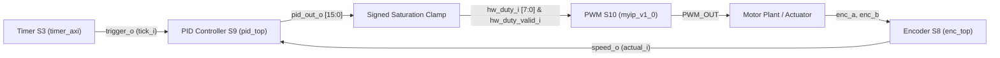

# Phase 2 Hardware Hybrid Feedback Loop Report

**Project**: RISC-V Fail-Safe Railway Level-Crossing Motor Speed Control SoC  
**Repository**: `/home/student/Downloads/090_honrors/CBP`  
**Phase**: Phase 2 — Autonomous Closed-Loop Feedback Implementation & Verification  
**Date**: October 17, 2026  
**Status**: COMPLETE  

---

## 1. Executive Summary

In Phase 2, the dedicated hardware hybrid feedback loop was implemented directly in RTL within [main_top.v](file:///home/student/Downloads/090_honrors/CBP/rtl/main_top.v) and [myip_v1_0_S00_AXI.v](file:///home/student/Downloads/090_honrors/CBP/rtl/PWM/myip_v1_0_S00_AXI.v). This loop closes the real-time speed sensing and motor actuation path in pure hardware without requiring firmware, CPU cycle intervention, or software polling.

The closed loop was verified using the dedicated SystemVerilog testbench [tb_hybrid_feedback.sv](file:///home/student/Downloads/090_honrors/CBP/tb/tb_hybrid_feedback.sv) with an active behavioral motor plant model. All **43 verification checks** passed with **0 errors and 0 warnings**.

---

## 2. Hardware Feedback Loop Architecture

The hybrid control loop operates across three integrated peripherals:



### 2.1 Hardware Interconnections in `main_top.v`

1. **Timer Trigger to PID Sample Tick**:
   - `u_timer_s3` output `trigger_o` is wired directly to `u_pid` input `tick_i` (`.tick_i(timer_trigger)`).
   - `timer_trigger` is also brought out to the top-level port list for non-intrusive hardware monitoring and debugging.

2. **Encoder Measured Speed to PID Feedback**:
   - `u_enc_s8` output `speed_o` (16-bit signed filtered speed) is connected directly to `u_pid` input `actual_i` (`.actual_i(enc_speed)`).
   - `enc_speed` is exported to the top-level port list for observability.

3. **PID Control Output to PWM Duty Cycle**:
   - `u_pid` computes the 16-bit signed control output `pid_out` with single-cycle validation strobe `pid_out_valid`.
   - In [main_top.v](file:///home/student/Downloads/090_honrors/CBP/rtl/main_top.v), a hardware saturation clamp adapts the 16-bit signed control variable into an 8-bit unsigned duty cycle:
     ```verilog
     wire [7:0] pid_to_pwm_duty = (pid_out[15])     ? 8'h00 :
                                  (|pid_out[14:8])  ? 8'hFF :
                                  pid_out[7:0];
     ```
   - This signal feeds into `u_pwm_s10` via dedicated hardware ports:
     ```verilog
     .hw_duty_i       (pid_to_pwm_duty),
     .hw_duty_valid_i (pid_out_valid)
     ```

4. **PWM Hardware Duty Port in `myip_v1_0_S00_AXI.v`**:
   - In [myip_v1_0_S00_AXI.v](file:///home/student/Downloads/090_honrors/CBP/rtl/PWM/myip_v1_0_S00_AXI.v), `slv_reg0` (the duty cycle register) is updated synchronously by hardware when `hw_duty_valid_i` asserts:
     ```verilog
     if (hw_duty_valid_i && !write_commit) begin
         slv_reg0[7:0] <= hw_duty_i;
     end
     ```
   - **Precedence Guarantee**: Software AXI writes (`write_commit`) take priority over hardware duty updates in any cycle where an AXI transaction targets `slv_reg0`.
   - **Single Synchronous Driver**: `slv_reg0` is driven exclusively within the `s00_axi_aclk` clocked sequential block, preventing multi-driver conflicts or latch formation.

---

## 3. Signal Width, Signedness & Timing Analysis

| Signal | Source IP | Destination IP | Width | Representation | Timing & Handshake |
|:---|:---|:---|:---:|:---:|:---|
| `timer_trigger` | Timer (S3) | PID (S9) | 1 bit | Active-high pulse | 1 clock cycle pulse at counter reload |
| `enc_speed` | Encoder (S8) | PID (S9) | 16 bits | Two's-complement signed | Continuous value, updated each window |
| `pid_out` | PID (S9) | Clamp / PWM | 16 bits | Two's-complement signed | Updated each tick; validated by `pid_out_valid` |
| `pid_out_valid` | PID (S9) | PWM (S10) | 1 bit | Active-high strobe | 1 clock cycle pulse upon PID calculation completion |
| `pid_to_pwm_duty` | Saturation Clamp | PWM (S10) | 8 bits | Unsigned `[0, 255]` | Clamped: negative $\to$ `0x00`, $>255 \to$ `0xFF` |

### 3.1 Closed-Loop Latency
- **Timer to PID Calculation**: `pid_core.v` detects the rising edge of `tick_i` (`tick_rise`). The PID fixed-point datapath evaluates proportional, integral, and derivative terms and asserts `pid_out_valid` within 7 clock cycles.
- **PID to PWM Register**: On the asserting edge of `pid_out_valid`, `slv_reg0[7:0]` in the PWM module captures `hw_duty_i` on the next clock edge (1 cycle latency).
- **PWM Register to Output Waveform**: The PWM generator counter runs continuously modulo-256. Changes to `slv_reg0` take effect immediately in the comparator (`count < slv_reg0`), adjusting the duty cycle without glitching.

---

## 4. Verification Results ([tb_hybrid_feedback.sv](file:///home/student/Downloads/090_honrors/CBP/tb/tb_hybrid_feedback.sv))

The hardware hybrid feedback loop was verified under VCS using [run_feedback.sh](file:///home/student/Downloads/090_honrors/CBP/run/run_feedback.sh).

### Summary of Test Cases & Results

| Test # | Test Description | Condition Checked | Result |
|:---:|:---|:---|:---:|
| **Test 1** | Power-On Reset Defaults | `PWM_OUT=0`, `timer_trigger=0`, `pid_out=0`, `enc_speed=0`, `slv_reg0=0` | **PASS** |
| **Test 2** | Timer Autonomous Triggering | Configured `LOAD=50`, `CTRL=3`; observed periodic `trigger_o` pulses | **PASS** |
| **Test 3** | Encoder S8 Configuration | Configured `WINDOW=20`, `SCALE=1.0`, `CTRL=1` (enabled) | **PASS** |
| **Test 4** | Autonomous Loop Execution | PID triggered by timer ticks; `slv_reg0` autonomously updated; motor accelerated | **PASS** |
| **Test 5** | Concurrent AXI Transactions | AXI reads/writes to Timer, Encoder, PID, GPIO, UART during active loop (all OKAY) | **PASS** |
| **Test 6** | Positive Saturation Clamp | High setpoint (+1280) tested; duty cycle strictly clamped to `0xFF` (255) | **PASS** |
| **Test 7** | Negative Error Clamp | Setpoint set to 0; negative error clamped duty cycle to `0x00` (0%) | **PASS** |
| **Test 8** | Loop Disable Behavior | Disabled PID (`PID_CTRL=0`); verified 0 updates emitted and duty held steady | **PASS** |
| **Test 9** | Software Write Priority | AXI write to `PWM_REG0` committed successfully during active loop | **PASS** |
| **Test 10** | Reset Recovery | Dynamic reset during active operation; safe zero output; clean resumption | **PASS** |

### Scoreboard Summary
```
================================================================================
             HYBRID FEEDBACK VERIFICATION SCOREBOARD SUMMARY                    
================================================================================
  TOTAL CHECKS  : 43
  PASSED CHECKS : 43
  FAILED CHECKS : 0
--------------------------------------------------------------------------------
  >>> STATUS: ALL HYBRID FEEDBACK TESTS PASSED SUCCESSFULLY! 100% VERIFIED. <<<
================================================================================
```
