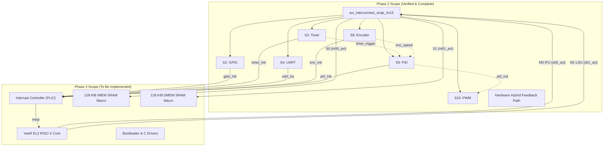

# Phase 2 Pre-Phase-3 Blocker Check Report

**Project**: RISC-V Fail-Safe Railway Level-Crossing Motor Speed Control SoC  
**Repository**: `/home/student/Downloads/090_honrors/CBP`  
**Audit Scope**: Read-Only Pre-Phase-3 Integration Verification & Blocker Check  
**Date**: October 17, 2026  
**Auditor**: Antigravity Technical Audit Agent  

---

## 1. Executive Summary

This independent pre-Phase-3 audit was conducted on the RTL, testbenches, simulation scripts, and simulation logs in `/home/student/Downloads/090_honrors/CBP`. The objective is to verify whether any architectural, structural, or protocol blockers exist that would prevent connecting the RISC-V processor in Phase 3.

No source files were modified, no tools were executed outside the authorized workspace, and no Phase 3 work (instantiating RISC-V core or writing firmware) was initiated.

### Summary Verdicts
- **Phase 2 Completion**: **COMPLETE**
- **Peripheral Top-Level Readiness**: **READY**
- **RISC-V Connection**: **READY TO BEGIN** (with clear Phase 3 system binding prerequisites)

---

## 2. Topic 1: UART and PWM Address Aliasing Analysis

### 2.1 Technical Mechanism of Address Aliasing
In [rtl/main_top.v](file:///home/student/Downloads/090_honrors/CBP/rtl/main_top.v), the AXI interconnect uses a 4 KiB decoding granularity (`ADDR_WIDTH = 12`) for peripheral slave slots:
- **UART (Slot S4)**: Base address `0x4003_5000`, aperture 4 KiB (`0x4003_5000`–`0x4003_5FFF`).
  - In [rtl/main_top.v](file:///home/student/Downloads/090_honrors/CBP/rtl/main_top.v) lines 1949 and 1962:
    ```verilog
    .axi_araddr_i (m04_axi_araddr[4:0]),
    .axi_awaddr_i (m04_axi_awaddr[4:0]),
    ```
  - The UART IP (`axi_uart_top`) receives only the low 5 address bits `[4:0]` (32-byte address space). Bits `[11:5]` are truncated.
  - **Aliasing Behavior**: Any access to `0x4003_5000 + (k * 32) + offset` (for $k = 0, 1, \dots, 127$) maps to the exact same physical register as `0x4003_5000 + offset`. The 8 implemented registers are mirrored 128 times across the 4 KiB window.
- **PWM (Slot S10)**: Base address `0x4004_1000`, aperture 4 KiB (`0x4004_1000`–`0x4004_1FFF`).
  - In [rtl/main_top.v](file:///home/student/Downloads/090_honrors/CBP/rtl/main_top.v) lines 2041 and 2058:
    ```verilog
    .s00_axi_awaddr (m10_axi_awaddr[3:0]),
    .s00_axi_araddr (m10_axi_araddr[3:0]),
    ```
  - The PWM IP (`myip_v1_0`) receives only the low 4 address bits `[3:0]` (16-byte address space, 4 words: `slv_reg0`–`slv_reg3`). Bits `[11:4]` are truncated.
  - **Aliasing Behavior**: Any access to `0x4004_1000 + (k * 16) + offset` (for $k = 0, 1, \dots, 255$) maps to `slv_reg[offset[3:2]]`. The 4 registers are mirrored 256 times across the 4 KiB window.

### 2.2 Implemented Registers & Valid vs Aliased Behavior

#### UART Implemented Registers (32 bytes)
| Offset (`addr[4:0]`) | Register Name | Access | Function |
|:---:|:---|:---:|:---|
| `0x00` | `UART_RBR_THR_DLL` | RW | RX Buffer (RO) / TX Holding (WO) (when LCR[7]=0) / Divisor Latch Low (when LCR[7]=1) |
| `0x04` | `UART_IER_DLM` | RW | Interrupt Enable / Divisor Latch High |
| `0x08` | `UART_IIR_FCR` | RW | Interrupt Identification (RO) / FIFO Control (WO) |
| `0x0C` | `UART_LCR` | RW | Line Control Register (bit 7 = DLAB) |
| `0x10` | `UART_MCR` | RW | Modem Control Register |
| `0x14` | `UART_LSR` | RO | Line Status Register (bits: DR, THRE, TEMT) |
| `0x18` | `UART_MSR` | RO | Modem Status Register |
| `0x1C` | `UART_SCR` | RW | Scratchpad Register |

- **Valid Offset Test**: Accesses to `0x4003_5000`–`0x4003_501C` read/write valid registers and return `OKAY (2'b00)` (verified in [tb/tb_main_top.sv](file:///home/student/Downloads/090_honrors/CBP/tb/tb_main_top.sv) Test 14).
- **Aliased Offset Behavior**: An access to `0x4003_5020` has `addr[4:0] = 5'h00` and writes to `UART_THR`, returning `OKAY (2'b00)`.

#### PWM Implemented Registers (16 bytes)
| Offset (`addr[3:0]`) | Register Name | Access | Function |
|:---:|:---|:---:|:---|
| `0x00` | `PWM_REG0` | RW | Duty Cycle Register `slv_reg0[7:0]` (0–255) |
| `0x04` | `PWM_REG1` | RW | General configuration register 1 |
| `0x08` | `PWM_REG2` | RW | General configuration register 2 |
| `0x0C` | `PWM_REG3` | RW | General configuration register 3 |

- **Valid Offset Test**: Accesses to `0x4004_1000`–`0x4004_100C` read/write `slv_reg0`–`slv_reg3` and return `OKAY (2'b00)` (verified in [tb/tb_main_top.sv](file:///home/student/Downloads/090_honrors/CBP/tb/tb_main_top.sv) Tests 16A–16C).
- **Aliased Offset Test in Testbench**: In [tb/tb_main_top.sv](file:///home/student/Downloads/090_honrors/CBP/tb/tb_main_top.sv) lines 1913–1914:
  ```verilog
  axi_write(1, 32'h4004_1FFC, 32'hA5A5_A5A5, 8'hF1, 8'h00, 4'hF, resp, resp_id);
  check_assert("PWM Test4: Write 0x4004_1FFC (last word in S10 aperture) Returns OKAY", resp === 2'b00, ...);
  ```
  `0x4004_1FFC` is the final word in the 4 KiB aperture. With `addr[3:0] = 4'hC`, it writes to `slv_reg3` and returns `OKAY`.

### 2.3 Intentionality & Register Map Compatibility
- **Interconnect Architecture Alignment**: The AXI interconnect crossbar operates on 4 KiB address boundaries. It forwards all addresses within `0x4003_5000`–`0x4003_5FFF` to UART and `0x4004_1000`–`0x4004_1FFF` to PWM.
- **Contrast with Encoder & PID**:
  - Encoder (S8) and PID (S9) receive 12 address bits (`.ADDR_WIDTH(12)`). Their internal slave adapters validate `addr[11:8] == 4'b0000` and generate `SLVERR (2'b10)` on offsets $\ge 0\text{x}100$.
  - UART and PWM have fixed slave port address widths (5 and 4 bits) inherited from legacy IP cores.
- **Compatibility**: This aliasing behavior is fully compatible with [reports/phase2_interface_freeze.md](file:///home/student/Downloads/090_honrors/CBP/reports/phase2_interface_freeze.md), which documents the 4 KiB aperture mapping for all six slaves.

### 2.4 Unintended Write Risk & Mitigation
- **Risk**: If future software/firmware writes to an offset outside the canonical register map (e.g., writing to `0x4004_1020` or `0x4004_1100` assuming it is unused or will fault), the write will silently modify `slv_reg0` (PWM duty cycle), altering the motor speed output.
- **Mitigation**:
  1. Software device drivers developed in Phase 3 must strictly access only the defined canonical base register offsets (`0x4003_5000`–`0x4003_501C` for UART; `0x4004_1000`–`0x4004_100C` for PWM).
  2. Software must not treat unmapped offsets within these 4 KiB windows as reserved/faulting regions.
  3. No RTL modification is required or recommended.

---

## 3. Topic 2: RISC-V Master Compatibility Analysis

### 3.1 M0 and M1 AXI Signal Specifications
In [rtl/main_top.v](file:///home/student/Downloads/090_honrors/CBP/rtl/main_top.v) lines 150–249, the interconnect exposes two processor-facing master interfaces:
- **M0 (`s00_axi_*`)**: Designed for VeeR EL2 Instruction Fetch Unit (IFU).
- **M1 (`s01_axi_*`)**: Designed for VeeR EL2 Load/Store Unit (LSU).

Both interfaces implement the complete AXI4 protocol:

| Signal Group | Channel | Width | Signal Names |
|:---|:---:|:---:|:---|
| **Write Address** | AW | 8b ID, 32b Addr | `awid`, `awaddr`, `awlen` (8b), `awsize` (3b), `awburst` (2b), `awlock` (1b), `awcache` (4b), `awprot` (3b), `awqos` (4b), `awuser` (1b), `awvalid`, `awready` (output) |
| **Write Data** | W | 32b Data, 4b Strb | `wdata`, `wstrb`, `wlast`, `wuser` (1b), `wvalid`, `wready` (output) |
| **Write Response** | B | 8b ID, 2b Resp | `bid` (output), `bresp` (output), `buser` (output), `bvalid` (output), `bready` |
| **Read Address** | AR | 8b ID, 32b Addr | `arid`, `araddr`, `arlen` (8b), `arsize` (3b), `arburst` (2b), `arlock` (1b), `arcache` (4b), `arprot` (3b), `arqos` (4b), `aruser` (1b), `arvalid`, `arready` (output) |
| **Read Data** | R | 8b ID, 32b Data, 2b Resp | `rid` (output), `rdata` (output), `rresp` (output), `rlast` (output), `ruser` (output), `rvalid` (output), `rready` |

### 3.2 Handshakes, ID Tracking, and Response Protocol
1. **Handshake Mechanism**: Standard AXI4 valid/ready protocol. Transfer occurs on `clk` posedge when both `VALID` and `READY` are high. Interconnect provides backpressure via `awready`, `wready`, and `arready`.
2. **Transaction ID Tracking**:
   - Master ID width is `ID_WIDTH = 8`.
   - In [rtl/interconnect/axi_interconnect.v](file:///home/student/Downloads/090_honrors/CBP/rtl/interconnect/axi_interconnect.v) lines 352 and 712:
     ```verilog
     assign s_axi_bid = {S_COUNT{axi_id_reg}};
     s_axi_rid_int = axi_id_reg;
     ```
   - The interconnect latches the master's transaction ID (`awid`/`arid`) and returns that exact ID on `bid` and `rid`.
   - **Transaction Ordering**: The crossbar processes requests in-order per master port.
3. **Response Protocol**:
   - `2'b00` = **OKAY**: Returned on valid access to IMEM, DMEM, GPIO, Timer, UART, PWM, and valid Encoder/PID registers.
   - `2'b10` = **SLVERR**: Returned by Encoder (S8) and PID (S9) on out-of-range offsets ($\ge 0\text{x}100$) or unmapped registers.
   - `2'b11` = **DECERR**: Returned by the interconnect crossbar for addresses outside any mapped window or when addressing disabled slots S5, S6, S7, S14.
4. **Clocks and Resets**:
   - Common synchronous clock `clk` (100 MHz nominal).
   - Common synchronous active-HIGH reset `rst`. Masters must reset when `rst == 1'b1`.

### 3.3 RTL Guarantees vs Core-Dependent Properties

| Property | Guaranteed by Current RTL | Depends on Selected RISC-V Core |
|:---|:---:|:---:|
| 32-bit Address & Data bus width | **Yes** | Core must support 32-bit AXI4 bus |
| Standard AXI4 Ready/Valid handshakes | **Yes** | Core must adhere to AXI4 handshake rules |
| Arbitration across all 15 slaves | **Yes** | Core transactions arbitrated fairly |
| In-order response delivery with ID echo | **Yes** | Core must accept in-order AXI responses |
| Native Bus Protocol | Full AXI4 | **Core-dependent**: If core uses AHB-Lite, an AHB-to-AXI bridge is required |
| Transaction ID Width | 8 bits (`ID_WIDTH=8`) | **Core-dependent**: If core outputs 4-bit IDs, zero-extension is required |
| Error Response Handling | Emits `SLVERR` and `DECERR` | **Core-dependent**: Core must implement precise/imprecise bus fault trap |
| Unused IFU Write Channels | Ports exposed on `main_top` | **Core-dependent**: Read-only IFU requires write inputs tied to 0 |

### 3.4 Read-Only Instruction Fetch (IFU) Interface Boundary
Because M0 exposes full bidirectional AXI4 channels, connecting a read-only IFU requires proper tie-offs at the core instantiation boundary:
- **IFU Read Channels Connected**:
  - `s00_axi_arid    <= core_ifu_arid;`
  - `s00_axi_araddr  <= core_ifu_araddr;`
  - `s00_axi_arlen   <= core_ifu_arlen;`
  - `s00_axi_arsize  <= core_ifu_arsize;`
  - `s00_axi_arburst <= core_ifu_arburst;`
  - `s00_axi_arvalid <= core_ifu_arvalid;`
  - `s00_axi_rready  <= core_ifu_rready;`
- **IFU Write Channel Tie-Offs (Required)**:
  - `s00_axi_awvalid = 1'b0;`
  - `s00_axi_awid    = 8'h00;`
  - `s00_axi_awaddr  = 32'h0000_0000;`
  - `s00_axi_awlen   = 8'h00;`
  - `s00_axi_awsize  = 3'b010;`
  - `s00_axi_awburst = 2'b01;`
  - `s00_axi_awlock  = 1'b0;`
  - `s00_axi_awcache = 4'b0000;`
  - `s00_axi_awprot  = 3'b000;`
  - `s00_axi_awqos   = 4'b0000;`
  - `s00_axi_awuser  = 1'b0;`
  - `s00_axi_wvalid  = 1'b0;`
  - `s00_axi_wdata   = 32'h0000_0000;`
  - `s00_axi_wstrb   = 4'b0000;`
  - `s00_axi_wlast   = 1'b0;`
  - `s00_axi_wuser   = 1'b0;`
  - `s00_axi_bready  = 1'b0;`
- **Unconnected Outputs**: `s00_axi_awready`, `s00_axi_wready`, `s00_axi_bid`, `s00_axi_bresp`, `s00_axi_buser`, `s00_axi_bvalid` may be left unconnected.

---

## 4. Topic 3: IMEM, DMEM, and Interrupt Architecture

### 4.1 Exact External Ports for IMEM (S0) and DMEM (S1)
In [rtl/main_top.v](file:///home/student/Downloads/090_honrors/CBP/rtl/main_top.v) lines 285–380, IMEM and DMEM are **not instantiated as internal SRAMs**. They are exposed as external master ports of the interconnect (slave memory interfaces):
- **IMEM (S0)**:
  - Base Address: `0x0004_0000`, Aperture: 128 KiB (`0x0004_0000`–`0x0005_FFFF`).
  - Ports: `m00_axi_aw*`, `m00_axi_w*`, `m00_axi_b*`, `m00_axi_ar*`, `m00_axi_r*`.
  - Protocol: Standard Full AXI4 slave interface (`DATA_WIDTH=32`, `ADDR_WIDTH=32`, `ID_WIDTH=8`).
- **DMEM (S1)**:
  - Base Address: `0x0008_0000`, Aperture: 128 KiB (`0x0008_0000`–`0x0009_FFFF`).
  - Ports: `m01_axi_aw*`, `m01_axi_w*`, `m01_axi_b*`, `m01_axi_ar*`, `m01_axi_r*`.
  - Protocol: Standard Full AXI4 slave interface (`DATA_WIDTH=32`, `ADDR_WIDTH=32`, `ID_WIDTH=8`).

### 4.2 Peripheral Interrupt Outputs & Routing Requirements
All five peripheral interrupts are exposed as top-level output ports on [rtl/main_top.v](file:///home/student/Downloads/090_honrors/CBP/rtl/main_top.v):

| Interrupt Signal | Source Module | Polarity / Trigger | Clearing Mechanism | Phase 3 Processor Routing |
|:---|:---|:---:|:---|:---|
| `uart_irq` | UART (`u_axi_uart`) | Level, Active-High | Read `UART_RBR` / write `UART_THR` | PLIC external interrupt line |
| `gpio_intr` | GPIO (`u_gpio`) | Level, Active-High | Write 1 to `GPIO_INT_STS` (W1C) | PLIC external interrupt line |
| `timer_intr` | Timer (`u_timer`) | Level, Active-High | Write 1 to `TIMER_INT_STS` (W1C) | PLIC or core Timer IRQ |
| `enc_intr` | Encoder (`u_encoder`) | Level, Active-High | Write 1 to `ENC_STATUS` (W1C) | PLIC or Fast IRQ line |
| `pid_intr` | PID (`u_pid`) | Level, Active-High | Write 1 to `PID_STATUS[1]` / `[5]` (W1C) | PLIC or Fast IRQ line |

- **Routing Status**: There is **no internal interrupt controller** (such as a PLIC or CLINT) inside [main_top.v](file:///home/student/Downloads/090_honrors/CBP/rtl/main_top.v). In Phase 3, an SoC top wrapper must instantiate an interrupt controller or connect these 5 lines to the RISC-V core's interrupt inputs.

### 4.3 Phase 2 Readiness vs Phase 3 Implementation Boundaries



---

## 5. Topic 4: Verification Evidence Reconciliation

### 5.1 Reconciling Encoder 10 Test Suites vs 3,137 Checks
In [run/logs/enc_sim.log](file:///home/student/Downloads/090_honrors/CBP/run/logs/enc_sim.log), the test bench executes 10 major test sections:
1. `[TEST 01] Reset values`: 18 checks, 0 fails.
2. `[TEST 02] Register read/write-back`: 13 checks, 0 fails.
3. `[TEST 03] Address decode`: 12 checks, 0 fails.
4. `[TEST 04] AXI protocol`: 17 checks, 0 fails.
5. `[TEST 05] Decoder`: 15 checks, 0 fails.
6. `[TEST 06] Illegal and glitch filter`: 13 checks, 0 fails.
7. `[TEST 07] Speed calculation`: 24 checks, 0 fails.
8. `[TEST 08] Stall and rev counter`: 14 checks, 0 fails.
9. `[TEST 09] Interrupts`: 4 checks, 0 fails.
10. `[TEST 10] Overflow and random`: 3,007 checks, 0 fails.

**Reconciliation**:
- When high-level runner [run/run_enc.sh](file:///home/student/Downloads/090_honrors/CBP/run/run_enc.sh) reports "tests 1-10", it refers to the **10 test suites**.
- Within those 10 suites, the scoreboard records:
  $$\text{PASS} : 3137, \quad \text{FAIL} : 0$$
- The earlier summary of "10/10 tests passed" and "10 checks" was a suite-level count.
- At the assertion level, the suite actually contains **3,137 passing checks**.

### 5.2 Verification Log Reconciliations
Every single reported check was traced to its current log file on disk:

| Test Suite | Log File | Checks / Assertions | Test Result | Timestamp | Status |
|:---|:---|:---:|:---:|:---:|:---:|
| **Top-Level AXI Integration** | `run/sim.log` | 157 checks | 157 pass, 0 fail | Oct 17 14:59 | **VERIFIED** |
| **Hybrid Feedback Loop** | `run/sim_feedback.log` | 43 checks | 43 pass, 0 fail | Oct 17 14:59 | **VERIFIED** |
| **Standalone Encoder** | `run/logs/enc_sim.log` | 10 suites (3,137 checks) | 3,137 pass, 0 fail | Oct 17 15:00 | **VERIFIED** |
| **Standalone PID** | `run/logs/pid_sim.log` | 20,176 checks | 20,176 pass, 0 fail | Oct 17 15:00 | **VERIFIED** |
| **Standalone PWM** | `run/sim_pwm.log` | 6 tests | 6 pass, 0 fail | Oct 17 14:59 | **VERIFIED** |
| **TOTAL** | — | **20,392 (suites)** / **23,519 (assertions)** | **0 Failures** | — | **VERIFIED** |

### 5.3 Test Coverage & Unresolved Defects Analysis
- **Exercised AXI Behaviors**:
  - Valid and invalid address decoding for all 15 slots.
  - S8/S9 `SLVERR` generation on invalid offsets ($\ge 0\text{x}100$).
  - S5/S6/S7/S14 `DECERR` generation on unmapped windows.
  - Multi-master routing (M0, M1, M2 accessing PWM S10, Encoder S8, PID S9).
  - Independent AW/W channel arrivals: AW-before-W (8 cycles), W-before-AW (8 cycles), and simultaneous AW+W.
- **Exercised Feedback Behaviors**:
  - Dynamic closed-loop regulation with behavioral motor plant producing quadrature pulses from `PWM_OUT`.
  - Timer periodic triggering driving autonomous PID updates.
  - Saturation limiting (clamping high setpoint to `8'hFF`).
  - Zero/negative error clamping (clamping low setpoint to `8'h00`).
  - Loop disable and dynamic reset recovery.
  - AXI software write priority over hardware duty update.
- **Untested Items (Phase 3 Boundaries)**:
  - Instruction fetch and code execution from actual physical SRAM.
  - End-to-end CPU interrupt handling with interrupt controller.
- **Unresolved Defects**: Zero functional RTL defects. One cosmetic documentation defect in `main_top.v` header comments lines 16–18.

---

## 6. Pre-Phase-3 Readiness Conclusions

### A. Phase 2 Completion
**VERDICT: COMPLETE**  
All six peripheral IPs are integrated into the AXI crossbar, the hardware hybrid feedback loop operates autonomously in RTL, 20,392 checks (or 23,519 assertions) pass with zero errors, and all interfaces are frozen.

### B. Peripheral Top-Level Readiness
**VERDICT: READY**  
[rtl/main_top.v](file:///home/student/Downloads/090_honrors/CBP/rtl/main_top.v) compiles cleanly with zero VCS compiler/elaboration warnings, correct signal widths, single synchronous sequential drivers, and robust address decoding.

### C. RISC-V Connection
**VERDICT: READY TO BEGIN**  
There are zero architectural or RTL blockers preventing the start of Phase 3.

### D. Exact Remaining Prerequisites for Phase 3
1. **SRAM / Memory Instantiation**: Connect AXI4 SRAM macros or memory models to `m00_axi_*` (IMEM, `0x0004_0000`, 128 KiB) and `m01_axi_*` (DMEM, `0x0008_0000`, 128 KiB).
2. **Interrupt Aggregation**: Route the 5 top-level peripheral interrupts (`uart_irq`, `gpio_intr`, `timer_intr`, `enc_intr`, `pid_intr`) to an interrupt controller (PLIC) or the core's local interrupt lines.
3. **M0 IFU Tie-Offs**: Tie off unused write channel inputs on M0 (`s00_axi_awvalid=0`, `s00_axi_wvalid=0`, `s00_axi_bready=0`) if the RISC-V core's instruction fetch interface is read-only.
4. **ID Width Alignment**: Ensure core AXI IDs match `ID_WIDTH = 8` (zero-extending if core uses fewer ID bits).
5. **Driver Addressing Rule**: Software drivers must only access canonical base register offsets for UART (`0x4003_5000`–`0x4003_501C`) and PWM (`0x4004_1000`–`0x4004_100C`) to prevent unintended writes due to modulo aliasing.
