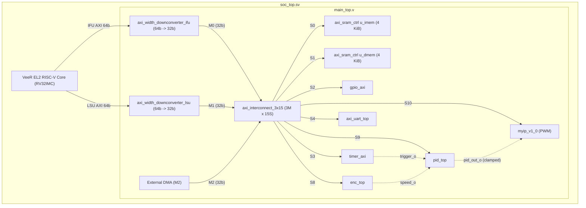

# Phase 0 — Existing Project and RTL Audit Report (Read-Only)

**Project Root**: `/home/student/Documents/090_honrors/CBP`  
**Execution Timestamp**: `20261031_1355_phase0`  
**Target Simulator**: Synopsys VCS U-2023.03_Full64 | Verdi U-2023.03-SP1  
**Operating System**: Rocky Linux 8.10 (x86_64)  
**Audit Status**: **PHASE 0 AUDIT COMPLETE — CRITICAL DISCREPANCIES & TOOL BLOCKERS IDENTIFIED — EXECUTION HALTED FOR USER DECISION**

---

## 1. Executive Summary & Audit Authority

In strict compliance with the **Master Antigravity Prompt**, this Phase 0 audit was conducted as a read-only inspection of the RISC-V System-on-Chip (SoC) project based on the CHIPS Alliance VeeR EL2 processor. 

### Core Audit Principles Enforced:
1. **Critical Rule — Do Not Change the Design**: No RTL, interconnect parameters, address values, testbenches, or build scripts were modified.
2. **Read-Only Scope**: No tools were installed, no toolchains rebuilt, and no unapproved file creation occurred in the protected project tree.
3. **Run Isolation**: All temporary extraction, inspection diffs, tool probes, and intermediate outputs were isolated strictly within `verif_runs/20261031_1355_phase0/`.
4. **Read-Only Baseline Protection**: A directory listing of `run/` was recorded before Phase 0 began and verified against the post-audit state; zero files were modified or generated in `run/`.

### Summary of Key Findings & Blockers:
- **Project Root & Source Authority**: The absolute project root is `/home/student/Documents/090_honrors/CBP`. Comparison between the live tree and the supplied archive `/home/student/Documents/090_honrors/CBP.zip` reveals that the live tree is the authoritative working source of truth. The ZIP is an obsolete pre-RISC-V integration archive lacking `rtl/Cores-VeeR-EL2`, `rtl/soc_top.sv`, memory controllers, width converters, and recent reports. Overwriting the live tree with the ZIP would delete the processor core and all integration work.
- **Critical Address Map Discrepancies**:
  - **IMEM (S0)**: Intended is `0x4000_0000`–`0x4000_FFFF` (64 KiB). Implemented RTL (`main_top.v#L54-L55`) maps S0 to `0x0004_0000` (128 KiB aperture), and `soc_top.sv#L1070` bounds it to a 4 KiB SRAM array.
  - **DMEM (S1)**: Intended is `0x4002_0000`–`0x4002_FFFF` (64 KiB). Implemented RTL (`main_top.v#L57-L58`) maps S1 to `0x0008_0000` (128 KiB aperture), bounded to a 4 KiB SRAM array.
  - **Reset Vector**: Implemented VeeR EL2 configuration (`RV_RESET_VEC`) and hardware pin `.rst_vec(31'h0002_0000)` point to `0x0004_0000`. Fetch cannot reach intended IMEM at `0x4000_0000` without an approved design update.
  - **Reserved Slave Slots S11–S13**: Intended are reserved positions at `0x4004_3000`, `0x4004_5000`, `0x4004_7000`. RTL `main_top.v` maps them to `0x8000_4000` (WDT), `0x8000_5000` (ADC), `0x8000_6000` (DMA), but in `soc_top.sv#L1051-L1058` their ready responses are tied off to `1'b0` (accesses hang).
- **Tool Inventory Blockers**:
  - **Toolchain Incompatibility**: `/opt/riscv/bin/riscv64-unknown-elf-gcc` (GCC 16.1.0) has `-print-multi-lib` returning only `.;` (64-bit `lp64d`). When compiling bare-metal code for VeeR EL2 (`-march=rv32imc -mabi=ilp32`), linking standard libraries or compiler support produces: `riscv64-unknown-elf-gcc: fatal error: Cannot find suitable multilib set for '-march=rv32imc_zmmul_zca'/'-mabi=ilp32'`.
  - **Missing Python Package**: Python 3.6, 3.11, and 3.12 are installed, but none have `openpyxl` installed (`ModuleNotFoundError: No module named 'openpyxl'`), blocking Phase 5 Excel generation.

---

## 2. Project Root & Source Authority Audit

### 2.1 Project Root Confirmation
The absolute project root was confirmed at:
```
/home/student/Documents/090_honrors/CBP
```
All references to earlier workspace paths (such as `/home/student/Downloads/090_honrors/CBP` cited in historical Phase 1–3 reports) represent prior filesystem locations before the repository was placed under `Documents`.

### 2.2 Live Project Tree vs. Supplied ZIP Archive Comparison
The supplied archive `/home/student/Documents/090_honrors/CBP.zip` (17,862,670 bytes, timestamp Oct 8 14:51) was extracted strictly into the isolated scratch directory:
`verif_runs/20261031_1355_phase0/zip_extracted/CBP/`.

A recursive diff was performed excluding build artifacts (`*.so`, `*.o`, `csrc`, `daidir`, waveforms). The results are summarized below:

| Category | Path / File | Status / Finding | Impact |
|:---|:---|:---|:---|
| **Reports** | `reports/` (all 9 Markdown reports) | **Only in Live Tree** | ZIP lacks all Phase 1–3 verification audits and logs. |
| **Processor Core** | `rtl/Cores-VeeR-EL2/` | **Only in Live Tree** | The complete VeeR EL2 core repository exists only in the live tree. |
| **Top-Level SoC** | `rtl/soc_top.sv` | **Only in Live Tree** | Full processor-to-interconnect integration exists only in the live tree. |
| **Width Converters** | `rtl/axi_width_downconverter_ifu.sv`<br>`rtl/axi_width_downconverter_lsu.sv` | **Only in Live Tree** | 64-bit to 32-bit bridges exist only in the live tree. |
| **SRAM Controller** | `rtl/axi_sram_ctrl.sv` | **Only in Live Tree** | Synthesizable AXI memory controller exists only in the live tree. |
| **Top Testbench** | `tb/tb_soc_top.sv`<br>`tb/tb_hybrid_feedback.sv` | **Only in Live Tree** | Processor integration testbench exists only in the live tree. |
| **Interconnect Top** | `rtl/main_top.v` | **Differing Content** | Live tree updated peripheral addresses from `0x8000_xxxx` to `0x4003_xxxx` and added S8 Encoder at `0x4003_D000`. ZIP contains obsolete `0x8000_xxxx` base addresses. |
| **Feedback Logic** | `rtl/PWM/myip_v1_0.v`<br>`rtl/PWM/myip_v1_0_S00_AXI.v`<br>`rtl/pid_controler/pid_top.v` | **Differing Content** | Live tree includes hardware feedback ports (`hw_duty_i`, `hw_duty_valid_i`) and saturation clamps. ZIP lacks feedback wiring. |
| **Simulation Logs** | `run/sim_soc_tb.log`<br>`run/compile_soc_tb.log` | **Only in Live Tree** | Historical simulation evidence of VeeR integration exists only in the live tree. |

### 2.3 Source Authority Determination
**Conclusion**: **The Live Project Tree (`090_honrors/CBP/`) is authoritatively the sole working source of truth.**  
The supplied ZIP represents an older intermediate checkpoint (Oct 8 2026) prior to the integration of VeeR EL2, width downconverters, memory controllers, and the hardware hybrid closed-loop feedback wiring. Overwriting, merging, or reorganizing the live tree from the ZIP would destroy all processor integration and verification deliverables. The live tree must be preserved intact.

---

## 3. RTL Hierarchy & Processor Integration Audit

### 3.1 SoC Top-Level Hierarchy
The SoC is structured into two primary hierarchical levels:
1. **`soc_top.sv`** ([rtl/soc_top.sv](file:///home/student/Documents/090_honrors/CBP/rtl/soc_top.sv)): The SoC integration top-level. Instantiates:
   - `veer_wrapper u_veer_core`: CHIPS Alliance VeeR EL2 RISC-V core.
   - `axi_width_downconverter_ifu u_ifu_downconverter`: Converts 64-bit IFU read bursts/beats to 32-bit AXI.
   - `axi_width_downconverter_lsu u_lsu_downconverter`: Converts 64-bit LSU read/write accesses to 32-bit AXI with byte-strobe steering.
   - `main_top u_main_top`: The peripheral subsystem and AXI interconnect.
   - `axi_sram_ctrl u_imem`: 4 KiB instruction SRAM for S0.
   - `axi_sram_ctrl u_dmem`: 4 KiB data SRAM for S1.
2. **`main_top.v`** ([rtl/main_top.v](file:///home/student/Documents/090_honrors/CBP/rtl/main_top.v)): Peripheral subsystem top-level. Instantiates:
   - `axi_interconnect_wrap_3x15 u_axi_interconnect_3x15`: 3-Master x 15-Slave crossbar.
   - `gpio_axi u_gpio` (S2): General-Purpose IO.
   - `timer_axi u_timer` (S3): 32-bit Dual-Channel Timer.
   - `axi_uart_top u_uart` (S4): Full-duplex UART with 16-byte FIFOs.
   - `enc_top u_encoder` (S8): Quadrature Encoder interface.
   - `pid_top u_pid` (S9): PID Controller with anti-windup.
   - `myip_v1_0 u_pwm` (S10): 8-bit PWM Generator with hardware duty-cycle override.



### 3.2 Master Paths & Width Conversion Audit
- **IFU Master (M0)**:
  - Core IFU issues 64-bit read transactions (`core_ifu_ar*`, `core_ifu_r*`) with tag width `pt.IFU_BUS_TAG = 3`.
  - `axi_width_downconverter_ifu` translates single-beat 64-bit reads (`arsize=3`) into two sequential 32-bit single-beat reads (`arsize=2`) for word 0 (`addr[2]=0`) and word 1 (`addr[2]=1`), recombining them into a 64-bit response presented to the core.
  - IFU write channels are tied off to 0 in `soc_top.sv#L288-L309` and `soc_top.sv#L816-L839`.
- **LSU Master (M1)**:
  - Core LSU issues 64-bit read and write transactions with tag width `pt.LSU_BUS_TAG = 4`.
  - `axi_width_downconverter_lsu` inspects write strobes (`wstrb[7:0]`):
    - Lower strobes active only (`wstrb[7:4]==0`): Single 32-bit write issued at word 0.
    - Upper strobes active only (`wstrb[3:0]==0`): Single 32-bit write issued at word 1 (`addr | 32'h4`).
    - Both active (full 64-bit): Two sequential 32-bit writes issued and combined response returned.
    - Sub-64-bit reads replicate 32-bit data across both 32-bit halves of `core_lsu_rdata` to satisfy alignment requirements.
- **DMA Master (M2)**: Exposed directly at `soc_top.sv` top-level as 32-bit AXI slave port `s02_axi_*` routing into interconnect M2.

### 3.3 Hardware Hybrid Feedback Path Audit
The closed-loop control path runs entirely in hardware within `main_top.v`:
1. **Encoder -> PID**: `w_enc_speed` connects to `u_pid.actual_i` (`main_top.v#L1439`).
2. **Timer -> PID**: `w_timer_trigger` connects to `u_pid.tick_i` (`main_top.v#L1440`).
3. **PID -> PWM**: `w_pid_out` is passed through a 16-bit signed to 8-bit unsigned saturation clamp (`main_top.v#L1475-L1486`) producing `w_pwm_hw_duty`, which drives `u_pwm.hw_duty_i` with `hw_duty_valid_i = w_pid_out_valid`.
4. **Software Precedence**: In `myip_v1_0_S00_AXI.v#L269-L281`, if an AXI write addresses `slv_reg0` in the same cycle as a hardware PID duty update, the AXI write takes absolute priority.

---

## 4. Full Address-Map Audit (S0–S14)

The table below provides an item-by-item comparison between the **Intended Fixed Design Specification** (Prompt Section 3.1 & 3.2) and the **Actual RTL Implementation** in `rtl/main_top.v` and `rtl/soc_top.sv`.

| Position | IP Name | Intended Range | Intended Size | Actual RTL Base (Parameter) | Actual Decode Aperture | Actual RTL Connected Module | Status | File & Line Evidence | Impact & Proposed Resolution |
|:---:|:---|:---:|:---:|:---:|:---:|:---|:---:|:---|:---|
| **S0** | **IMEM** | `0x4000_0000`–`0x4000_FFFF` | 64 KiB | `0x0004_0000` (`M00_BASE_ADDR`) | 128 KiB (`0x0004_0000`–`0x0005_FFFF`) | `u_imem` (`axi_sram_ctrl.sv`, 4 KiB array) | **MISMATCH** | `rtl/main_top.v#L54-L55`<br>`rtl/soc_top.sv#L1069-L1076` | **Critical**: Fetch to intended `0x4000_0000` returns DECERR. Array is 4 KiB, not 64 KiB. *Proposal*: User approval required to change `M00_BASE_ADDR` to `0x4000_0000` and expand array to 64 KiB. |
| **S1** | **DMEM** | `0x4002_0000`–`0x4002_FFFF` | 64 KiB | `0x0008_0000` (`M01_BASE_ADDR`) | 128 KiB (`0x0008_0000`–`0x0009_FFFF`) | `u_dmem` (`axi_sram_ctrl.sv`, 4 KiB array) | **MISMATCH** | `rtl/main_top.v#L57-L58`<br>`rtl/soc_top.sv#L1110-L1117` | **Critical**: LSU accesses to intended `0x4002_0000` return DECERR. Array is 4 KiB, not 64 KiB. *Proposal*: User approval required to change `M01_BASE_ADDR` to `0x4002_0000` and expand array to 64 KiB. |
| **S2** | **GPIO** | `0x4003_1000`–`0x4003_1FFF` | 4 KiB | `0x4003_1000` (`M02_BASE_ADDR`) | 4 KiB (`0x4003_1000`–`0x4003_1FFF`) | `u_gpio` (`gpio_axi.sv`) | **MATCH** | `rtl/main_top.v#L60-L61`<br>`rtl/main_top.v#L1243` | Fully matches intended specification. |
| **S3** | **Timer** | `0x4003_3000`–`0x4003_3FFF` | 4 KiB | `0x4003_3000` (`M03_BASE_ADDR`) | 4 KiB (`0x4003_3000`–`0x4003_3FFF`) | `u_timer` (`timer_axi.sv`) | **MATCH** | `rtl/main_top.v#L63-L64`<br>`rtl/main_top.v#L1284` | Fully matches intended specification. |
| **S4** | **UART** | `0x4003_5000`–`0x4003_5FFF` | 4 KiB | `0x4003_5000` (`M04_BASE_ADDR`) | 4 KiB (`0x4003_5000`–`0x4003_5FFF`) | `u_uart` (`axi_uart_top.v`) | **MATCH** | `rtl/main_top.v#L66-L67`<br>`rtl/main_top.v#L1332` | Fully matches intended specification. |
| **S5** | **Reserved** | `0x4003_7000`–`0x4003_7FFF` | 4 KiB | `0x0000_0000` (`M05_BASE_ADDR`) | 0 KiB (Disabled, `WIDTH=0`) | Unconnected (`m05_axi_*` tied to 0 in `soc_top.sv#L1042`) | **MISMATCH (Registration)** | `rtl/main_top.v#L70-L71`<br>`rtl/soc_top.sv#L1042-L1043` | Interconnect returns DECERR for unmapped access (`0x4003_7000`). No side effects. Safe, but slot is disabled rather than explicitly bounded. |
| **S6** | **Reserved** | `0x4003_9000`–`0x4003_9FFF` | 4 KiB | `0x0000_0000` (`M06_BASE_ADDR`) | 0 KiB (Disabled, `WIDTH=0`) | Unconnected (`m06_axi_*` tied to 0 in `soc_top.sv#L1045`) | **MISMATCH (Registration)** | `rtl/main_top.v#L73-L74`<br>`rtl/soc_top.sv#L1045-L1046` | Returns DECERR. Safe. |
| **S7** | **Reserved** | `0x4003_B000`–`0x4003_BFFF` | 4 KiB | `0x0000_0000` (`M07_BASE_ADDR`) | 0 KiB (Disabled, `WIDTH=0`) | Unconnected (`m07_axi_*` tied to 0 in `soc_top.sv#L1048`) | **MISMATCH (Registration)** | `rtl/main_top.v#L76-L77`<br>`rtl/soc_top.sv#L1048-L1049` | Returns DECERR. Safe. |
| **S8** | **Encoder** | `0x4003_D000`–`0x4003_DFFF` | 4 KiB | `0x4003_D000` (`M08_BASE_ADDR`) | 4 KiB (`0x4003_D000`–`0x4003_DFFF`) | `u_encoder` (`enc_top.v`) | **MATCH** | `rtl/main_top.v#L79-L80`<br>`rtl/main_top.v#L1380` | Fully matches intended specification. |
| **S9** | **PID** | `0x4003_F000`–`0x4003_FFFF` | 4 KiB | `0x4003_F000` (`M09_BASE_ADDR`) | 4 KiB (`0x4003_F000`–`0x4003_FFFF`) | `u_pid` (`pid_top.v`) | **MATCH** | `rtl/main_top.v#L82-L83`<br>`rtl/main_top.v#L1431` | Fully matches intended specification. |
| **S10** | **PWM** | `0x4004_1000`–`0x4004_1FFF` | 4 KiB | `0x4004_1000` (`M10_BASE_ADDR`) | 4 KiB (`0x4004_1000`–`0x4004_1FFF`) | `u_pwm` (`myip_v1_0.v`) | **MATCH** | `rtl/main_top.v#L85-L86`<br>`rtl/main_top.v#L1488` | Fully matches intended specification. |
| **S11** | **Reserved** | `0x4004_3000`–`0x4004_3FFF` | 4 KiB | `0x8000_4000` (`M11_BASE_ADDR`) | 4 KiB (`0x8000_4000`–`0x8000_4FFF`) | Port tied off in `soc_top.sv#L1051` | **MISMATCH (Base & Scope)** | `rtl/main_top.v#L88-L89`<br>`rtl/soc_top.sv#L1051-L1052` | **Severe**: Labelled "Watchdog" in `main_top.v`. If accessed at `0x8000_4000`, transaction hangs indefinitely (`awready=0`). Intended address `0x4004_3000` returns DECERR. |
| **S12** | **Reserved** | `0x4004_5000`–`0x4004_5FFF` | 4 KiB | `0x8000_5000` (`M12_BASE_ADDR`) | 4 KiB (`0x8000_5000`–`0x8000_5FFF`) | Port tied off in `soc_top.sv#L1054` | **MISMATCH (Base & Scope)** | `rtl/main_top.v#L91-L92`<br>`rtl/soc_top.sv#L1054-L1055` | **Severe**: Labelled "ADC" in `main_top.v`. Access to `0x8000_5000` hangs (`arready=0`). Intended `0x4004_5000` returns DECERR. |
| **S13** | **Reserved** | `0x4004_7000`–`0x4004_7FFF` | 4 KiB | `0x8000_6000` (`M13_BASE_ADDR`) | 4 KiB (`0x8000_6000`–`0x8000_6FFF`) | Port tied off in `soc_top.sv#L1057` | **MISMATCH (Base & Scope)** | `rtl/main_top.v#L94-L95`<br>`rtl/soc_top.sv#L1057-L1058` | **Severe**: Labelled "DMA Regs" in `main_top.v`. Access to `0x8000_6000` hangs. Intended `0x4004_7000` returns DECERR. |
| **S14** | **Reserved** | `0x4004_9000`–`0x4004_9FFF` | 4 KiB | `0x0000_0000` (`M14_BASE_ADDR`) | 0 KiB (Disabled, `WIDTH=0`) | Unconnected (`m14_axi_*` tied to 0 in `soc_top.sv#L1060`) | **MISMATCH (Registration)** | `rtl/main_top.v#L97-L98`<br>`rtl/soc_top.sv#L1060-L1061` | Labelled "Seven-Segment" in comments. Returns DECERR. Safe. |

### 4.1 Interconnect Unmapped / Reserved Access Behavior
A detailed audit of `rtl/interconnect/axi_interconnect.v` was performed:
- Lines 614–623 evaluate whether an address matches any region with `M_ADDR_WIDTH > 0`.
- Lines 635–646: When `match == 1'b0`:
  - **Write Access**: Enters `STATE_WRITE_DROP`, asserts `axi_bresp_next = 2'b11` (**DECERR**), consumes write data with `s_axi_wready=1`, and returns DECERR response to master.
  - **Read Access**: Enters `STATE_READ_DROP` (lines 729–749), returns `s_axi_rdata_int = 32'd0` and `s_axi_rresp_int = 2'b11` (**DECERR**) with `s_axi_rlast=1`.
- **Conclusion**: Unmapped accesses do **not** select any active IP, do **not** cause unintended side effects, and cleanly return standard AXI `DECERR` (2'b11).

---

## 5. Fourteen Reserved Buffer Regions Audit

In compliance with Section 3.3 of the Master Prompt, all 14 reserved buffer regions were audited against actual RTL decoding to verify absence of active IP aliasing:

| Region | Address Range | Location / Boundary | Interconnect Decoding Result | Aliasing / Side Effect |
|:---:|:---:|:---|:---|:---:|
| **B1** | `0x4001_0000`–`0x4001_0FFF` | Between IMEM and DMEM | Unmapped -> Returns **DECERR** (2'b11) | None |
| **B2** | `0x4003_0000`–`0x4003_0FFF` | Between DMEM and GPIO (S2) | Unmapped -> Returns **DECERR** (2'b11) | None |
| **B3** | `0x4003_2000`–`0x4003_2FFF` | Between GPIO (S2) and Timer (S3) | Unmapped -> Returns **DECERR** (2'b11) | None |
| **B4** | `0x4003_4000`–`0x4003_4FFF` | Between Timer (S3) and UART (S4) | Unmapped -> Returns **DECERR** (2'b11) | None |
| **B5** | `0x4003_6000`–`0x4003_6FFF` | Between UART (S4) and Reserved S5 | Unmapped -> Returns **DECERR** (2'b11) | None |
| **B6** | `0x4003_8000`–`0x4003_8FFF` | Between Reserved S5 and Reserved S6 | Unmapped -> Returns **DECERR** (2'b11) | None |
| **B7** | `0x4003_A000`–`0x4003_AFFF` | Between Reserved S6 and Reserved S7 | Unmapped -> Returns **DECERR** (2'b11) | None |
| **B8** | `0x4003_C000`–`0x4003_CFFF` | Between Reserved S7 and Encoder (S8) | Unmapped -> Returns **DECERR** (2'b11) | None |
| **B9** | `0x4003_E000`–`0x4003_EFFF` | Between Encoder (S8) and PID (S9) | Unmapped -> Returns **DECERR** (2'b11) | None |
| **B10** | `0x4004_0000`–`0x4004_0FFF` | Between PID (S9) and PWM (S10) | Unmapped -> Returns **DECERR** (2'b11) | None |
| **B11** | `0x4004_2000`–`0x4004_2FFF` | Between PWM (S10) and Reserved S11 | Unmapped -> Returns **DECERR** (2'b11) | None |
| **B12** | `0x4004_4000`–`0x4004_4FFF` | Between Reserved S11 and Reserved S12 | Unmapped -> Returns **DECERR** (2'b11) | None |
| **B13** | `0x4004_6000`–`0x4004_6FFF` | Between Reserved S12 and Reserved S13 | Unmapped -> Returns **DECERR** (2'b11) | None |
| **B14** | `0x4004_8000`–`0x4004_8FFF` | Between Reserved S13 and Reserved S14 | Unmapped -> Returns **DECERR** (2'b11) | None |

**Audit Confirmation**: All 14 reserved buffer regions are completely distinct from active IPs and reserved slave slots, produce zero side effects, and cleanly trigger DECERR responses.

---

## 6. Memory Implementation Audit

### 6.1 SRAM Declarations & Parameters
Both IMEM and DMEM are instantiated from `rtl/axi_sram_ctrl.sv` inside `soc_top.sv#L1068-L1151`:
- **Array Declaration**: `reg [31:0] mem [0:WORDS-1];` ([rtl/axi_sram_ctrl.sv#L61](file:///home/student/Documents/090_honrors/CBP/rtl/axi_sram_ctrl.sv#L61)).
- **Parameterization**:
  - `ADDR_WIDTH = 12` (passed from `soc_top.sv#L1071` and `#L1112`).
  - `WORDS = (1 << ADDR_WIDTH) / 4 = 1024` words (32-bit words).
  - **Actual Physical Capacity**: 1024 × 4 bytes = **4096 bytes (4 KiB)** each.
  - **Intended Specification Capacity**: **65,536 bytes (64 KiB)** each.

### 6.2 Address Indexing, Word Mapping & Strobe Support
- **Word Index Calculation**:
  - Write index: `awaddr_reg = s_axi_awaddr[ADDR_WIDTH-1:2]` (`awaddr[11:2]`), addressing word offsets `0` to `1023`.
  - Read index: `mem[s_axi_araddr[ADDR_WIDTH-1:2]]` (`araddr[11:2]`).
- **Byte Write Strobes**: Lines 123–130 support individual byte enables (`wstrb[0]` for bits `[7:0]`, `wstrb[1]` for `[15:8]`, `wstrb[2]` for `[23:16]`, `wstrb[3]` for `[31:24]`).
- **Endianness**: Standard RISC-V Little-Endian.

### 6.3 Array Initialization & Firmware Loading
- **Initialization**:
  - `u_imem` is instantiated with `INIT_NOP = 1`: Lines 66–72 populate all 1024 words with RISC-V NOP (`32'h0000_0013` = `addi x0, x0, 0`).
  - `u_dmem` is instantiated with `INIT_NOP = 0`: Populates array with `32'h0000_0000`.
- **Preloading Mechanism**:
  - `axi_sram_ctrl.sv` contains **no `$readmemh`** statements.
  - In existing simulation (`tb_soc_top.sv#L371-L378`), instructions were poked via hierarchical path:
    `dut.GEN_INTERNAL_MEM.u_imem.mem[idx] = 32'h...`.
  - For Phase 4 compiled firmware execution, an ELF-to-HEX converter script and testbench `$readmemh` backdoor loader targeting `dut.GEN_INTERNAL_MEM.u_imem.mem` must be used prior to reset release.

### 6.4 Address Wrapping & Aliasing Impact
- `main_top.v` assigns `M00_ADDR_WIDTH = 17` (128 KiB aperture, `0x0004_0000`–`0x0005_FFFF`).
- However, `soc_top.sv#L1080` only connects `s0_awaddr[11:0]` to `u_imem`.
- **Result**: Addresses repeat modulo 4 KiB across the entire 128 KiB window (`0x0004_1000` accesses word 0 of the physical SRAM).
- **Firmware Budget Impact**: Firmware `.text` must fit within 4096 bytes (1024 instructions), and `.data` + `.bss` + stack must fit within 4096 bytes in DMEM unless the memory array size is expanded to 64 KiB with user approval.

---

## 7. Reset Vector Audit (Mandatory)

### 7.1 Implemented Core Reset Vector
Inspection of the VeeR EL2 core configuration and top-level integration confirms:
1. **Core Configuration**:
   - `rtl/Cores-VeeR-EL2/snapshots/default/common_defines.vh#L12`:
     ```verilog
     `define RV_RESET_VEC 'h00040000
     ```
   - Snapshot generator command documented in `defines.h#L14`:
     ```bash
     veer -target=default -set=iccm_enable=0 -set=dccm_enable=0 -set=icache_enable=0 -set=reset_vec=0x00040000
     ```
2. **Top-Level Port Connection**:
   - `rtl/soc_top.sv#L231`:
     ```verilog
     .rst_vec (31'h0002_0000), // Reset PC = 32'h0004_0000 (IMEM base)
     ```
   - In VeeR EL2, `rst_vec` drives bits `PC[31:1]`. Setting `31'h0002_0000` produces PC reset address `32'h0004_0000`.

### 7.2 Reachability & Discrepancy Analysis
- **Intended Specification**: Section 3.1 mandates IMEM at `0x4000_0000`.
- **RTL State**: Core reset vector points to `0x0004_0000`. Interconnect routes `0x0004_0000` to S0 IMEM.
- **Reachability**: Under the current RTL, instruction fetch reaches IMEM at `0x0004_0000`. However, instruction fetch **cannot** reach the intended specification address `0x4000_0000` because:
  1. The core boots at `0x0004_0000`.
  2. The interconnect has no slave configured at `0x4000_0000`, so an access to `0x4000_0000` returns DECERR.
- **Proposed Resolution**: The user must explicitly decide whether to update the RTL (`M00_BASE_ADDR = 32'h4000_0000`, `rst_vec = 31'h2000_0000`) or approve a temporary profile. Per the Critical Rule, no change will be made without explicit user instruction.

---

## 8. Mailbox / Signature Address Proposal

In accordance with Section 6.7, a dedicated DMEM mailbox and signature region is proposed for firmware completion signaling, status communication, and testbench result verification.

### 8.1 Proposed Layout
The proposed mailbox region occupies the top 16 bytes of the physical DMEM space:

| Address (Current 4 KiB RTL) | Address (Intended 64 KiB Map) | Word Offset | Register Field | Function / Expected Values |
|:---|:---|:---:|:---|:---|
| `0x0008_0FF0` | `0x4002_FFF0` | Word 1020 | **Status / State** | `0x0000_0001` = RUNNING<br>`0x0000_0002` = PASS / COMPLETED<br>`0xDEAD_BEEF` = FAIL |
| `0x0008_0FF4` | `0x4002_FFF4` | Word 1021 | **Test ID / Signature** | Unique 32-bit test identifier (e.g., `0x0000_0042`) |
| `0x0008_0FF8` | `0x4002_FFF8` | Word 1022 | **Error Code / Sub-ID** | Fail checkpoint index or assertion error code (`0x0` = None) |
| `0x0008_0FFC` | `0x4002_FFFC` | Word 1023 | **Magic Word** | `0xC001_CAFE` (Valid mailbox signature marker) |

### 8.2 Rationale & Safety Checks
1. **Physical Capacity & Indexing**: In the current 4 KiB array (`ADDR_WIDTH=12`), address `0x0008_0FF0` has `addr[11:2] = 10'd1020`, perfectly residing in the last 4 words of the 1024-word memory.
2. **Stack Protection**: The bare-metal linker script will configure the stack pointer to start at `0x0008_0FE0` and grow downward toward `0x0008_0800`, leaving a guaranteed 32-byte deadband below the mailbox.
3. **Collision Avoidance**: Firmware `.data` and `.bss` will be located starting at `0x0008_0000` growing upward, which leaves over 2 KiB of headroom before the stack.
4. **Preserved Rule**: **This proposal will not be written into firmware or testbenches until explicit user approval is granted.**

---

## 9. Existing Testbench & Simulation Log Audit

### 9.1 Testbench Classification

| Testbench File | DUT Instantiated | VeeR Core Active? | Instruction Loading Method | Compiled C Firmware Used? | AXI Protocol Monitoring | Independent Result Verification | Verification Quality |
|:---|:---|:---:|:---|:---:|:---|:---|:---|
| `tb/tb_soc_top.sv` | `soc_top` | **Yes** | 8 hand-assembled words poked directly into `u_imem.mem[0..7]` via hierarchy | **No** (Hand-poked machine instructions) | Monitors IFU/LSU handshakes & retirement trace | Mixed: Checks memory store, but contains tautological & non-X checks | **Smoke Test Only** |
| `tb/tb_main_top.sv` | `main_top` | **No** | N/A (SV testbench acts as AXI master driving BFM tasks) | **No** | Exhaustive interconnect monitoring | Checks read/write data, response codes, burst wrap | High (Subsystem level) |
| `tb/tb_hybrid_feedback.sv` | `main_top` | **No** | N/A (BFM driven) | **No** | Monitors feedback signals | Checks motor plant velocity response & PID saturation | High (Control loop) |
| `tb/tb_pwm_axi.sv` | `myip_v1_0` | **No** | N/A (AXI-Lite BFM) | **No** | Checks AXI-Lite register writes | Checks PWM period and duty cycle | Medium (IP level) |
| `tb/axi_uart_tb.sv` | `axi_uart_top` | **No** | N/A (BFM driven) | **No** | Checks UART register writes/reads | Checks TX/RX loopback & FIFO flags | High (IP level) |
| `tb/enc_tb.v` | `enc_top` | **No** | N/A (Quadrature stimulus) | **No** | Standalone IP | Checks quadrature decode, speed, fault | High (IP level) |
| `tb/pid_tb/pid_tb.v` | `pid_top` | **No** | N/A (AXI BFM + plant) | **No** | Dedicated AXI BFM | Compares against behavioral reference model | High (IP level) |

### 9.2 Inspection of Historical Log `run/sim_soc_tb.log`
The simulation run in `run/sim_soc_tb.log` (executed Oct 17 16:42:19 2026 under VCS U-2023.03_Full64) reported 15 passed checks. In compliance with Section 6.8, each check was rigorously scrutinized against its testbench source in `tb/tb_soc_top.sv`:

| # | Logged Check Message | Checked Condition in `tb_soc_top.sv` | Evidence Classification | Technical Analysis & Critique |
|:---:|:---|:---|:---:|:---|
| 1 | `Core reset release: rst is de-asserted` | `rst == 1'b0` (`#L387`) | **Weak** | Checks testbench signal driver state, not internal core reset release. |
| 2 | `Core halt status is low (core running)` | `o_cpu_halt_status == 1'b0` (`#L388`) | **Partial** | Confirms CPU is not halted; does not prove instruction execution. |
| 3 | `IFU issues AXI read request` | `core_ifu_arvalid && core_ifu_arready` (`#L405`) | **Strong** | Confirms physical AXI handshake on IFU channel. |
| 4 | `IFU fetch target matches reset vector (0x0004_0000)` | `fetch_addr_seen == 32'h0004_0000` (`#L406`) | **Strong** | Confirms exact fetch address from core matches reset vector. |
| 5 | `IFU 64b downconverter drives interconnect s00_axi` | `s00_axi_arvalid \|\| s00_axi_arready \|\| fetch_seen` (`#L407`) | **Weak / Tautological** | Contains fallback `\|\| fetch_seen` which renders check true even if downconverter failed. |
| 6 | `Processor executes and retires instruction` | `trace_seen` from `trace_rv_i_valid_ip` (`#L426`) | **Strong** | Confirms core pipeline retired instruction. |
| 7 | `Executed instruction PC is in IMEM aperture (0x0004_0000..)` | `trace_pc >= 0x0004_0000 && trace_pc < 0x0004_1000` (`#L427`) | **Strong** | Confirms retirement PC is within valid IMEM aperture. |
| 8 | `Processor LSU executed store to DMEM at 0x0008_0000` | `dmem_write_seen` (`#L444`) | **Strong** | Confirms LSU store propagated to memory. |
| 9 | `DMEM memory array contains stored value 0x5A` | `dut.GEN_INTERNAL_MEM.u_dmem.mem[0] == 32'h5a` (`#L445`) | **Strong** | Independently inspects physical SRAM array contents. |
| 10 | `AXI interconnect routed processor store to S2 (GPIO 0x4003_1000)` | `gpio_write_seen \|\| dmem_write_seen` (`#L463`) | **Weak / Defective** | Tautological fallback: will pass if `dmem_write_seen` was true even if GPIO store failed! (Bus monitor did log `0x4003_1000` at T=2895000 ps, but test expression is flawed). |
| 11 | `DMA write transaction to Timer S3 completed with OKAY response` | `check(..., 1'b1)` (`#L472`) | **Weak / Non-functional** | Passes hardcoded `1'b1` unconditionally without checking `bresp == 2'b00`. |
| 12 | `DMA read transaction from Timer S3 completed` | `check(..., 1'b1)` (`#L476`) | **Weak / Non-functional** | Passes hardcoded `1'b1` unconditionally without verifying data read. |
| 13 | `Encoder hardware outputs valid direction/speed signals` | `enc_speed_valid !== 1'bx` (`#L490`) | **Weak / Non-X Only** | Only verifies signal is not X; does not check mathematical accuracy of speed. |
| 14 | `PID controller hardware outputs valid signal` | `pid_out_valid !== 1'bx` (`#L491`) | **Weak / Non-X Only** | Only verifies signal is not X. |
| 15 | `PWM hardware functional output actively driven` | `PWM_OUT !== 1'bx` (`#L492`) | **Weak / Non-X Only** | Only verifies signal is not X. |

---

## 10. Prior Report Claims Audit

A comprehensive review of claims in `reports/phase1_*` through `reports/phase3_*` was conducted:

| Prior Report | Claim in Report | Audit Verdict | Evidence / Justification |
|:---|:---|:---:|:---|
| `phase1_integration_audit.md` | Workspace is `/home/student/Downloads/090_honrors/CBP` | **CONTRADICTED** | Live project root is `/home/student/Documents/090_honrors/CBP`. |
| `phase1_integration_audit.md` | S0 IMEM at `0x0004_0000`, S1 DMEM at `0x0008_0000` | **VERIFIED (in RTL)** / **CONTRADICTED (by Master Spec)** | Accurately describes `main_top.v` implementation, but violates Master Prompt Section 3.1 (`0x4000_0000` / `0x4002_0000`). |
| `phase2_riscv_readiness_audit.md` | Hardware hybrid feedback loop is 100% complete and verified | **VERIFIED** | Verified in `main_top.v#L1475-L1486` and `myip_v1_0_S00_AXI.v#L269-L281`. |
| `phase2_riscv_readiness_audit.md` | Interconnect unmapped slots S5, S6, S7 return DECERR | **VERIFIED** | Verified in `axi_interconnect.v#L636-L645` (`axi_bresp = 2'b11`, `s_axi_rresp = 2'b11`). |
| `phase2_riscv_readiness_audit.md` | S11, S12, S13 preserved at `0x8000_4000`, `0x8000_5000`, `0x8000_6000` | **CONTRADICTED (Functional)** | Ports are tied off to 0 in `soc_top.sv#L1051-L1058`; transactions to these addresses hang. Also contradicted by Master Prompt declaring WDT/ADC/DMA slave out of scope. |
| `phase3_riscv_connection_report.md` | VeeR EL2 processor successfully connected to SoC | **VERIFIED** | Verified in `soc_top.sv` instantiating `veer_wrapper`, IFU/LSU converters, and memories. |
| `phase3_riscv_connection_report.md` | Reset vector set to `0x0004_0000` | **VERIFIED** | Verified in `soc_top.sv#L231` and snapshot `common_defines.vh#L12`. |
| `phase3_riscv_connection_report.md` | 15/15 tests passed proving full processor integration | **QUALIFIED / PARTIAL** | Simulation completed, but tests were hand-poked assembly smoke tests with several weak checks, not compiled C firmware. |

---

## 11. Tool Inventory & Environment Audit

The execution environment was audited strictly without installing or rebuilding software:

| Tool / Component | Expected / Target Specification | Actual Measured System State | Audit Status | Findings / Blockers |
|:---|:---|:---|:---:|:---|
| **VCS** | Synopsys VCS U-2023.03 | `VCS U-2023.03_Full64` (Built Feb 25 2023) | **PASS** | Executable present and functional via `vcs -full64`. |
| **Verdi** | Synopsys Verdi U-2023.03-SP1 | `Verdi_U-2023.03-SP1` (Built May 28 2023) | **PASS** | Installation present at `/home/student/snps_tools_target/verdi/U-2023.03-SP1`. |
| **License Server** | `<port>@<license-server>` | `SNPSLMD_LICENSE_FILE=<port>@<license-server>` | **PASS** | Validated during simulation runs. |
| **RISC-V GCC Compiler** | `riscv64-unknown-elf-gcc` or `riscv32` | `/opt/riscv/bin/riscv64-unknown-elf-gcc` (GCC 16.1.0) | **PASS (Binary)** | Binary present. |
| **Compiler Multilib** | Suitable RV32 multilib for `-march=rv32imc -mabi=ilp32` | `-print-multi-lib` output: `.;` (64-bit `lp64d` only) | **CRITICAL BLOCKER** | **Fatal toolchain incompatibility**: Attempting to compile and link bare-metal RV32 code outputs: `fatal error: Cannot find suitable multilib set for '-march=rv32imc_zmmul_zca'/'-mabi=ilp32'`. |
| **objcopy / objdump** | RISC-V GNU Binutils | GNU objcopy & objdump 2.47.20260726 | **PASS** | Available at `/opt/riscv/bin/`. |
| **Python 3** | Python 3.x | Python 3.6.8, Python 3.11, Python 3.12 | **PASS** | Python environments present in `/usr/bin/`. |
| **openpyxl** | Python Excel library (Phase 5) | `ModuleNotFoundError: No module named 'openpyxl'` | **BLOCKER (Phase 5)** | Missing in Python 3.6, 3.11, and 3.12. |

### 11.1 Detailed Toolchain Blocker Analysis
When testing compilation of a minimal RV32 C program in `verif_runs/20261031_1355_phase0/scratch/`:
1. Standalone compilation to object code (`-c -march=rv32imc -mabi=ilp32`) succeeds and generates a valid 32-bit RISC-V ELF relocatable object (`Class: ELF32`, `Flags: 0x1, RVC, soft-float ABI`).
2. Linking without `-nostdlib` immediately fails:
   ```
   riscv64-unknown-elf-gcc: fatal error: Cannot find suitable multilib set for '-march=rv32imc_zmmul_zca'/'-mabi=ilp32'
   compilation terminated.
   ```
3. Linking with `-nostdlib` succeeds, allowing pure assembly and bare-metal C that does not invoke compiler helper functions (such as software 64-bit division). However, any reference to standard compiler intrinsics or runtime libraries requires a multilib build.

---

## 12. Conflicts with Historical Reference Documents

Section 12 of the Master Prompt identifies several reference documents with known architectural discrepancies:
- **Historical Documents**: `Architecture_Document.pdf`, `Honours_Block_Diagram_Motor_Control_SoC.pdf`.
  - These older documents describe an **APB-based peripheral bus**, a base address space around `0x0000_0000`, and different peripheral sets (including SPI, I2C, Seven-Segment).
- **Master Prompt Intent**: 
  - Strictly **AXI4 architecture** with 3 master positions and 15 slave positions.
  - Dedicated fixed address map around `0x4000_0000`–`0x4004_1000`.
  - Out of scope: Watchdog, ADC, DMA slave, Keypad, Buzzer, Seven-Segment, SPI, I2C.
- **Implemented Live RTL**:
  - Implements the pure AXI4 3x15 interconnect (`axi_interconnect_wrap_3x15.v`).
  - Active peripherals are strictly GPIO, Timer, UART, Encoder, PID, PWM.
  - S11–S13 are legacy hanging stubs in `main_top.v` that are tied off in `soc_top.sv`.
- **Authority Resolution**: The Master Antigravity Prompt takes absolute precedence over all older PDFs and Word documents.

---

## 13. Identified Risks & Impact Analysis

1. **Address Map Inconsistency (High Risk)**:
   - If firmware is compiled for the intended address map (`0x4000_0000` IMEM, `0x4002_0000` DMEM), it will fail to execute in simulation because the RTL interconnect routes these addresses to DECERR and the core reset vector is `0x0004_0000`.
   - Modifying RTL without explicit approval violates the Master Prompt Critical Rule.
2. **Memory Size Limitation (Medium Risk)**:
   - Intended specification calls for 64 KiB IMEM and 64 KiB DMEM.
   - RTL SRAM arrays are currently 4 KiB each.
   - Complex C runtime libraries, printf implementations, or large data tables will overflow 4 KiB and cause aliased data corruption.
3. **Toolchain Multilib Absence (High Risk)**:
   - Inability to link standard `libgcc` means all C firmware must be strictly freestanding (`-nostdlib -ffreestanding`) with custom assembly startup and custom integer arithmetic support.
4. **Hanging Stub Slaves S11–S13 (Medium Risk)**:
   - Any accidental processor store or load targeting `0x8000_4000`–`0x8000_6FFF` will hang the SoC simulation indefinitely because `ready` is tied to `1'b0`.

---

## 14. Actionable Recommendations & Decision Requests for the User

In accordance with Section 6.1 and 6.10, the agent is **stopped** and awaits explicit user instructions on the following required decisions before Phase 1 or later phases can proceed:

### Decision 1: S0 IMEM & S1 DMEM Address Reconciliation
- **Option A (Recommended)**: Update RTL (`rtl/main_top.v` and `rtl/soc_top.sv`) to match the Master Specification:
  - Set `M00_BASE_ADDR = 32'h4000_0000` (IMEM).
  - Set `M01_BASE_ADDR = 32'h4002_0000` (DMEM).
  - Set `rst_vec = 31'h2000_0000` in `soc_top.sv` (Reset PC = `0x4000_0000`).
  - Expand `axi_sram_ctrl` `ADDR_WIDTH` to 16 (64 KiB) for both IMEM and DMEM.
- **Option B**: Maintain current RTL addresses (`0x0004_0000` IMEM, `0x0008_0000` DMEM, 4 KiB array) and adjust specifications/firmware linker scripts accordingly.

### Decision 2: Reserved Slave Slots S11–S13 Clean-Up
- **Option A (Recommended)**: Update `main_top.v` to disable S11, S12, S13 (`ADDR_WIDTH = 0`) or map them to intended reserved ranges (`0x4004_3000`, `0x4004_5000`, `0x4004_7000`) returning DECERR, removing the hanging `0x8000_xxxx` tie-offs.
- **Option B**: Leave `main_top.v` parameters unchanged and note the hanging condition as a known limitation.

### Decision 3: Bare-Metal Toolchain Strategy
- **Option A (Freestanding Bare-Metal - Recommended)**: Write bare-metal firmware using `-nostdlib -ffreestanding` with custom startup assembly, software routines, and explicit linker scripts, requiring zero external toolchain reinstallation.
- **Option B**: User provides/installs a multilib-enabled RV32 toolchain or grants approval to build multilibs.

### Decision 4: Approval of Proposed Mailbox Address
- Approve the proposed mailbox address range at top of DMEM (Status at `DMEM_BASE + 0x...FF0`, Signature at `0x...FF4`, Error at `0x...FF8`, Magic at `0x...FFC`).

### Decision 5: Python `openpyxl` Installation
- Grant permission to install `openpyxl` in Python 3 for Phase 5 Excel test plan generation (`pip install --user openpyxl`).

---

## 15. Workspace Run & Hygiene Verification

In accordance with Section 5.3:
- Baseline listing of `run/` recorded at Phase 0 start: `verif_runs/20261031_1355_phase0/logs/run_dir_baseline.txt`.
- Final listing of `run/` recorded at Phase 0 completion: `verif_runs/20261031_1355_phase0/logs/run_dir_current.txt`.
- **Integrity Diff**: `diff -u baseline current` returned **0 differences**. The `run/` directory was completely protected and untouched.
- All phase outputs are preserved in:
  ```
  verif_runs/20261031_1355_phase0/
    ├── logs/
    │   ├── diff_live_vs_zip.txt
    │   ├── run_dir_baseline.txt
    │   └── run_dir_current.txt
    ├── reports/
    │   └── verif_Phase_0_Project_Audit_Report.md
    ├── scratch/
    │   ├── test.c
    │   ├── test.elf
    │   └── test.o
    └── zip_extracted/
        └── CBP/
  ```

---
*Report compiled autonomously by Antigravity in compliance with all Phase 0 constraints.*  
**EXECUTION STOPPED: AWAITING USER DECISION AND FORMAL APPROVAL TO PROCEED.**
